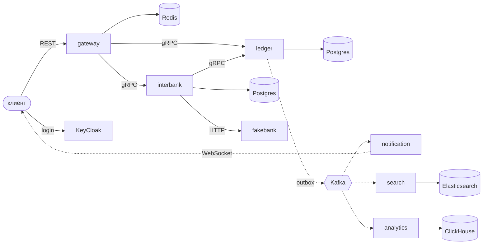

# Архитектура

Equilibra - платёжный сервис с внутренними счетами на double-entry ledger.
Баланс нигде не хранится, а считается из проводок. Сумма проводок любой транзакции равна 0.

Сейчас реализованы ledger (REST API + PostgreSQL), relay и notification. Ниже целевая схема.

## Схема

## Сервисы

- **gateway** - вход снаружи: роутинг, проверка JWT, rate limit в Redis. Своих данных нет.
- **KeyCloak** - пользователи и токены.
- **ledger** - счета, транзакции, проводки. Переводы, пополнения, выводы, баланс,
  выписка, резервы под межбанковские переводы.
- **interbank** - переводы в другие банки, своя БД со статусами переводов.
- **fakebank** - заглушка внешнего банка, отвечает медленно и с ошибками.
- **notification** - уведомления по WebSocket, читает события из Kafka.
- **search** - поиск по операциям, копия данных в Elasticsearch.
- **analytics** - отчёты, копия данных в ClickHouse.

У каждого сервиса своя БД, в чужие напрямую никто не ходит.
У счёта в ledger хранится id владельца из KeyCloak (`sub` из JWT).

## Почему ledger не делится

Всё, от чего зависит, можно ли провести операцию, должно быть строго согласовано,
поэтому живёт в одной БД и одной транзакции: переводы, проверка баланса под
`FOR UPDATE`, резервы, лимиты, выписка (пользователь должен сразу видеть свою операцию).
Если разделить ledger, понадобятся распределённые транзакции.

Остальное может отставать, поэтому вынесено отдельно: уведомления и поиск на секунды,
аналитика на минуты.

## Связи

- снаружи REST/JSON
- внутри синхронно gRPC: gateway -> ledger, gateway -> interbank, interbank -> ledger
- interbank -> fakebank по HTTP, как с настоящим внешним банком
- асинхронно через Kafka: ledger публикует события, их читают notification, search
  и analytics. Ledger про них не знает и от них не зависит.

На каждую проводку - одно событие `entry.posted`. Перевод даёт два события: списание
со счёта отправителя и зачисление на счёт получателя. События пишутся и для системных
счетов, потребители сами отбрасывают то, что им не нужно.

Поля: `event_id`, `account_id`, `transaction_id`, `transaction_type`, `amount`
(со знаком: плюс - зачисление, минус - списание), `counterparty_id`, `currency`,
`reversal_of` (только у сторно), `occurred_at`.

Ключ партиции - `account_id`, поэтому все события одного счёта идут по порядку.

## Outbox

Отправлять событие в Kafka прямо из транзакции нельзя. До коммита можно отправить
событие о транзакции, которая потом откатится. После коммита событие потеряется,
если процесс упадёт между коммитом и отправкой.

Поэтому событие пишется в таблицу `outbox` в той же транзакции, что и проводки.
Отдельный процесс relay забирает неотправленные строки пачками по порядку `id`,
отправляет в Kafka, дожидается подтверждения и помечает их отправленными.
Доставка at-least-once, потребители отбрасывают повторы по `event_id`.

Пачки обрабатывает только одна копия relay за раз: если бы две копии отправляли
разные пачки параллельно, более поздние события могли бы попасть в Kafka раньше
ранних. Каждая пачка начинается с `pg_try_advisory_xact_lock`, и копия, не получившая
блокировку, пропускает ход. Запасные копии подхватывают работу, если активная упадёт.

## Notification

Клиент подключается к любой копии notification по `GET /v1/ws?account_id=…`.
Событие из Kafka при этом читает копия, которой досталась партиция счёта, и это
может быть не та копия, у которой соединение.

Поэтому копии в одной consumer group, и каждое событие обрабатывает одна из них:
проверяет повтор по `event_id` и публикует уведомление в Redis pub/sub. Все копии
подписаны на канал и отправляют уведомление своим WebSocket-соединениям этого счёта.

Pub/sub ничего не хранит. Клиенты копии, которая в этот момент переподключалась
к Redis, уведомление не получат.

## Межбанковский перевод

1. interbank резервирует деньги в ledger: со счёта пользователя на транзитный счёт (`pending`)
2. отправляет перевод в fakebank со своим id как ключом идемпотентности (`sent`)
3. дальше по ответу:
   - успех: деньги с транзитного счёта уходят на счёт внешних расчётов (`completed`)
   - отказ: деньги возвращаются пользователю (`failed`)
   - таймаут: исход неизвестен. Повторяем запрос с тем же ключом и спрашиваем статус.
     Что зависло надолго, разбирается сверкой.

Внутренние переводы от fakebank не зависят.

## Масштабирование

Состояние лежит в Postgres, Redis и Kafka, поэтому сервисы можно запускать в нескольких копиях.

- ledger: блокировки в БД работают и между копиями
- gateway: счётчики rate limit в Redis, иначе у каждой копии был бы свой лимит
- notification: события раздаются всем копиям через Redis pub/sub (см. Notification)

Liveness-проверка не трогает БД, readiness проверяет.

## Если что-то упало

- gateway: снаружи недоступно всё
- ledger: деньги не ходят
- KeyCloak: работают уже выданные токены (gateway проверяет JWT сам), новых входов нет
- Redis: rate limit отключается, уведомления ждут, остальное работает
- Kafka: деньги ходят, события копятся в outbox
- notification, search, analytics: после рестарта дочитают пропущенные события
- interbank, fakebank: внутренние переводы работают, межбанковские ждут
